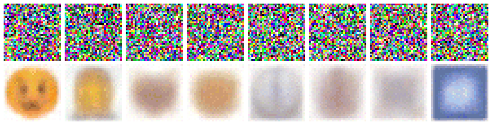
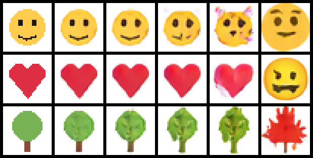
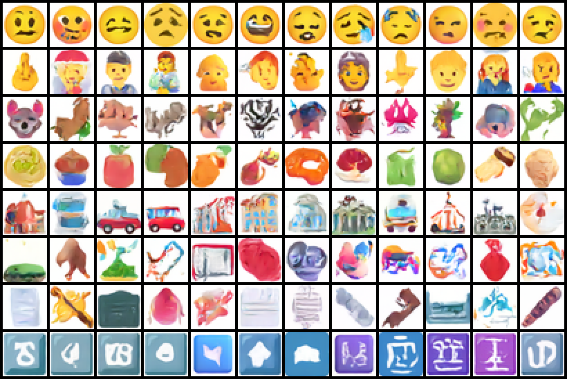
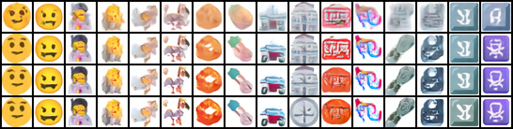

# Chisel

A 2.1M-parameter diffusion model, trained from scratch on emoji, that runs entirely in your browser. Drag a slider to scrub from pure noise to a finished emoji, sketch something and let it finish the drawing, or erase part of an image and have it refilled. No server.



*Top row: the noisy image the sampler holds. Bottom row: the model's guess of the final image at that step. One column per class.*

> The live demo is not deployed yet. To try it, [run it locally](#run-it); it takes two commands.

## Problem

Diffusion models are usually explained with a static diagram and a few cherry-picked samples. You cannot feel the process, and you never see where the model breaks. Most small-diffusion demos are MNIST digits in a notebook: not interactive, not shareable.

## Approach

Train a model small enough to ship as a static file, and put the **sampling loop** in the browser instead of exporting the whole sampler.

- The network is exported to ONNX as a single denoising step (8.7 MB, 32-bit floats, no quantization).
- The DDIM loop is about 130 lines of TypeScript ([web/src/sampler.ts](web/src/sampler.ts)), run in a Web Worker on WebGPU with a WASM fallback.
- Because the loop is ours, every intermediate image can be cached, so scrubbing costs nothing, and the loop can start from a sketch or hold part of an image fixed.

What you can do in the app:

- **Generate and scrub.** Pick one of 8 classes, then drag the ruler from noise to emoji. Toggle between the noisy image and the model's current guess.
- **Sketch to emoji.** Draw a rough filled shape; a strength slider sets how far the model may stray from it.
- **Repair.** Erase part of an image and the model refills only that part.
- **Share.** Seed, class, steps and guidance live in the URL. Sampling is deterministic, so a link reproduces the image. Export a PNG or a GIF of the process.



*Left column: a crude sketch. Then the model's completion at strength 0.2, 0.4, 0.6, 0.8 and 1.0. At 1.0 the sketch is ignored.*

## Results

Everything below is measured, including the parts that are unflattering. One training run, one seed.

| | |
| --- | --- |
| Training data | 4,548 images of 1,545 distinct emoji, from three vendors (Noto, Fluent, Twemoji), 32×32 |
| Train / held-out | 4,096 / 452, split by emoji so the same emoji never appears on both sides |
| Model | U-Net, 2,117,091 parameters, attention at 8×8, class-conditional, v-prediction |
| Training | 40,000 steps, batch 128, 66 minutes on a free Colab T4 with mixed precision |
| Model file | 8.7 MB ONNX, fp32 |



*One row per class: Smileys, People, Animals & Nature, Food & Drink, Travel & Places, Activities, Objects, Symbols. Not cherry-picked: the first 12 samples per class from one fixed seed, 20 steps, guidance 2.*

### Recognisability

A small classifier was trained on the real training emoji. "Recognised" is the share of generated images it assigns to the class that was asked for.

| Class | Real held-out emoji | Generated (guidance 2, 20 steps) |
| --- | --- | --- |
| Smileys & Emotion | 88% | 98% |
| People & Body | 95% | 100% |
| Animals & Nature | 67% | 99% |
| Food & Drink | 64% | 93% |
| Travel & Places | 58% | 94% |
| Activities | 12% | 36% |
| Objects | 62% | 85% |
| Symbols | 86% | 96% |
| **Overall** | **72%** | **88%** |

(The generated column is a local re-run, 87.6% overall. The ablation tables further down were computed on Colab, where the same setting gave 86.5%; the samples differ slightly between the two machines.)

Read this table carefully, because the generated column beating the real one is **not** good news about image quality:

- The classifier scores 98% on its own training set. The generator learned from the same training set, so its samples look like images the classifier has effectively seen. The fair statement is "generated samples sit between held-out (72%) and training (98%) data".
- Guidance pushes every sample toward the most typical look of its class, which is exactly what a classifier rewards. With guidance off the conditional model scores 67%, below real held-out data.
- **Activities is broken as a class.** Real Activities emoji are recognised 12% of the time, which is chance. It is a grab-bag (balls, medals, yarn, puzzle pieces) with the fewest examples.

### Sampling steps

| Steps | Recognised | Diversity |
| --- | --- | --- |
| 5 | 82.1% | 0.332 |
| 10 | 86.8% | 0.473 |
| 20 | 86.5% | 0.553 |
| 50 | 85.9% | 0.597 |

Recognisability is flat from 10 steps on. What more steps buy is diversity (mean pixel distance between two samples of the same class): at 5 steps the samples are blurry and alike. The default is 20.



*Rows: 5, 10, 20, 50 steps. Two samples per class, same seeds in every row.*

### Guidance scale

| Guidance | Recognised | Diversity |
| --- | --- | --- |
| 0 (label ignored) | 13.1% | 0.576 |
| 1 (no guidance) | 67.4% | 0.556 |
| 1.5 | 82.0% | 0.553 |
| 2 | 86.5% | 0.553 |
| 3 | 91.7% | 0.564 |
| 5 | 93.4% | 0.595 |

The textbook trade-off, more guidance for less diversity, **did not show up in this metric**: diversity is flat and even rises at guidance 5. Looking at the images, that is the metric's fault. High guidance produces harsher, higher-contrast images, and pixel distance counts contrast as variety. A feature-space measure would be the right tool; I have not built one.

### Is it copying the training set?

For 400 generated samples, the distance to the nearest training image (and its mirror), compared with the same measurement for real held-out emoji.

- Median distance: 0.318 for generated samples, 0.330 for real held-out emoji. On average a generated sample is as far from the training set as a genuinely new emoji is.
- **2.0% (8 of 400) are near-copies**, closer to a training image than 95% of held-out emoji are.


*Top: the 16 generated samples closest to any training image. Bottom: that training image.* The copies are clocks, hearts and plain faces: emoji that exist in many near-identical variants (24 clock faces times three vendors), so the model has seen essentially the same picture dozens of times.

### Does the browser compute the same thing as Python?

| Comparison | Max absolute difference |
| --- | --- |
| PyTorch vs ONNX Runtime, one step | 5.5e-6 |
| Python vs browser, one step, WebGPU | 9.1e-6 |
| Python vs browser, one step, WASM | 1.1e-5 |
| Python sampler vs TypeScript sampler, full 20-step image | 1.4e-4 (pixels in [-1, 1]) |
| WebGPU vs WASM, final image in the app | 1 level out of 255 |

### Speed

Measured in headless Chrome on a laptop with a GTX 1650. One step is one network call on a batch of two (conditional and unconditional).

| Backend | Per step | 20-step image |
| --- | --- | --- |
| WebGPU | 21 ms | about 0.4 s |
| WASM, single-threaded | 63 ms | about 1.3 s |

Not measured: any phone, any other laptop, multi-threaded WASM.

One unflattering number: the ONNX runtime's WASM binary is 26.8 MB (6.7 MB gzipped). **The runtime is a bigger download than the model.**

## The hard parts

**1. Epsilon-prediction quietly fails at the noisiest steps.** My first sanity check, overfitting 16 images, gave samples with the right colours but scrambled shapes, even though the loss looked fine. To separate "sampler bug" from "model problem" I drove the sampler with a closed-form perfect denoiser (for a handful of images the ideal answer is a weighted average of the training set). It landed on training images to within 3e-7, so the sampler was innocent. Measuring error per noise level showed the model was accurate up to step 700 and badly wrong above it. The cause: at high noise a large error in the implied clean image is a tiny error in predicted noise, so the loss barely notices, yet those are the steps that decide what the image will be. Switching to v-prediction fixed it; on the same test it produced clean white backgrounds where epsilon-prediction left tinted ones. That check still runs: `python train/diffusion.py`.

**2. A bug that only existed on WebGPU.** With v-prediction, I first baked the conversion back to noise into the exported graph, a lookup of one value from the schedule table. It matched Python to 1e-5 on WASM and was wrong by 2.4 on WebGPU, on the same file. An epsilon-prediction export of the same architecture passed on both, which pinned it on that lookup; the lookup on its own in a tiny graph also passed, so I have not found the root cause. The fix was to export the raw network and do the conversion in the sampler. The lesson is the boring one: the per-backend parity test ([export/smoke.html](export/smoke.html)) caught it within a minute of the trained weights arriving, and the images on WebGPU would have just looked "a bit off" otherwise.

**3. The model in my design doc was nearly twice the size I claimed.** I specified 32 base channels and called it "about 2M parameters". It is 3.76M and 14 MB. At 24 channels it is 2.12M and fits the 10 MB budget without quantizing.

**4. Cosine vs linear noise schedule was not close.** On a toy model the cosine schedule gave yellow faces and red hearts; the linear one gave blue-purple smears for every sample.

More failures, with pictures, are in the app under "Where it fails".

## Not done

- **Model-size ablation** (0.9M / 2.1M / 8.4M parameters). The code and notebook cell exist; the runs do not.
- **Quantization.** fp32 already fits the size budget, so fp16 and int8 are untested.
- **Speed on a phone**, and multi-threaded WASM.
- **A better diversity metric** (see the guidance section).
- **FID/KID.** Unreliable with 452 held-out images, so not reported.
- **Deployment.**

## Run it

The web app, with the trained model that is already in this repo:

```
cd web
npm install
npm run dev
```

Add `?wasm=1` to the URL to force the WASM backend.

Train it yourself: open [notebooks/train_colab.ipynb](notebooks/train_colab.ipynb) in Colab, choose a T4 GPU, and run all. Or locally:

```
pip install -r requirements.txt
python train/data.py                        # download and build the dataset
python train/train.py --name base           # train (add --amp on a GPU with tensor cores)
python train/eval.py classifier             # train the classifier used for scoring
python train/eval.py ablate --run base      # step and guidance tables
python train/eval.py memorize --run base    # nearest-training-image check
python export/export_onnx.py --run base     # ONNX + parity fixtures
cd web && npm test                          # TypeScript sampler vs Python sampler
```

## Layout

```
train/      data.py  unet.py  diffusion.py  train.py  eval.py  sample.py  toy.py
export/     export_onnx.py (single-step export + parity check)  smoke.html (per-backend browser check)
web/        src/sampler.ts  src/worker.ts  src/App.tsx  public/model/
notebooks/  train_colab.ipynb
```

## Credits

Trained on emoji from [Noto Emoji](https://github.com/googlefonts/noto-emoji) (Apache 2.0), [Fluent Emoji](https://github.com/microsoft/fluentui-emoji) (MIT) and [Twemoji](https://github.com/jdecked/twemoji) (graphics CC BY 4.0, © Twitter, Inc. and other contributors). Class labels come from the Unicode `emoji-test.txt`.

Built by [Rakesh Sawant](https://rakeshsawant.space).
